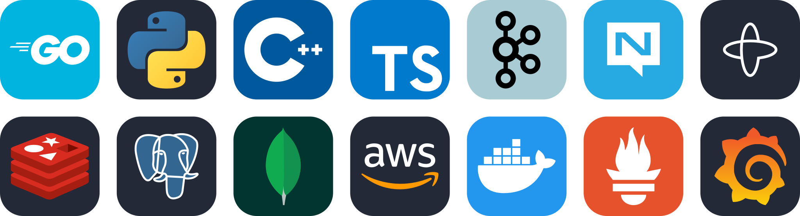

  

I'm a software engineer building low-latency trading systems and the distributed plumbing around them, mostly in **Go**. I like systems that keep running when nobody's watching: trading engines that read the market and place their own orders, event-driven pipelines, and an Instagram channel, [@deployai.hq](https://www.instagram.com/deployai.hq), that writes, voices and posts its own reels.

**Currently:** pair-programming with Claude Code. It writes the code; I still get paged at 3 AM.

 

  

 

